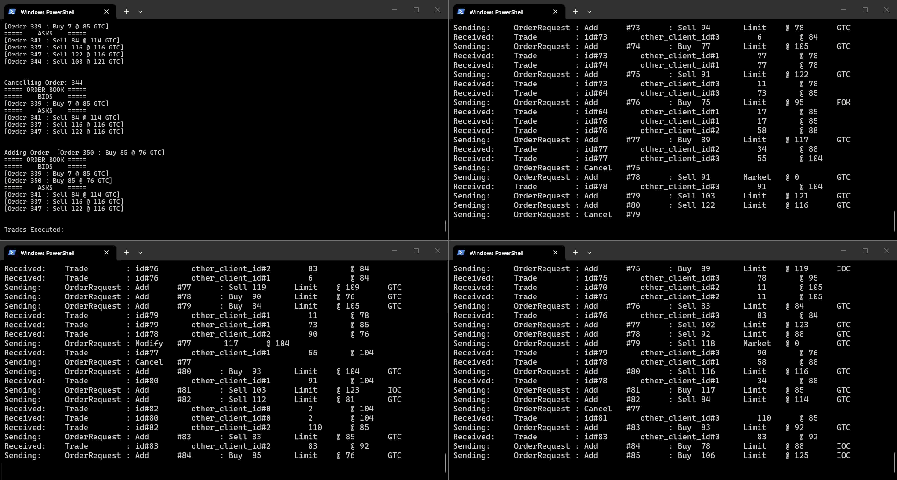
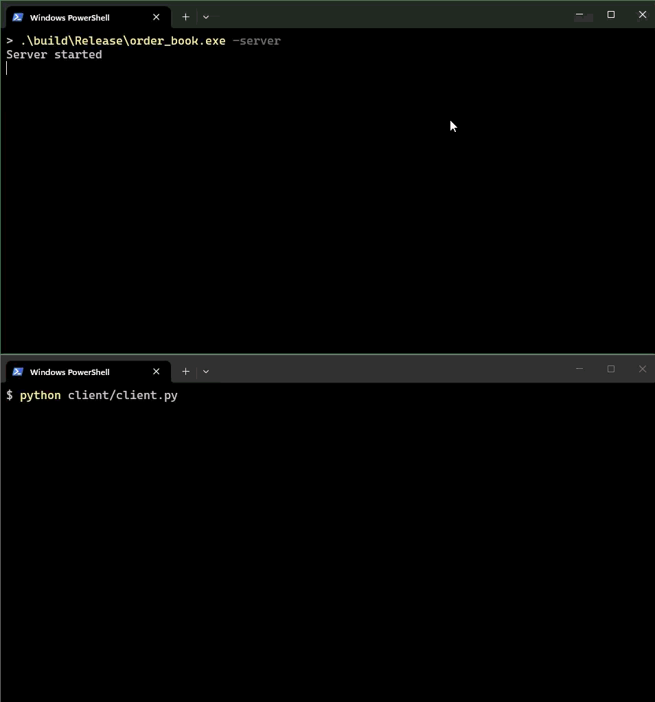
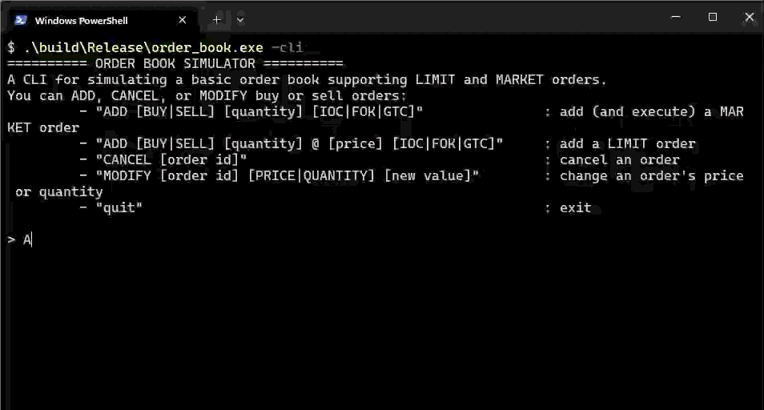

A C++20 order book with an asynchronous client/server interface for handling multiple concurrent clients. It supports **Limit** and **Market** orders with **Immediate or Cancel (IOC)**, **Fill or Kill (FOK)** and **Good 'Til Cancel (GTC)** time-in-force semantics.



I built this project to familiarise myself with the [Boost Asio](https://www.boost.org/doc/libs/latest/doc/html/boost_asio.html) networking API, to explore writing networking software in Python, to apply performance-focused C++ in a new domain (finance), and to extend my experience with software validation and evaluation techniques.

### Features
- Price-time priority matching (best price first, FIFO within a price level)
- Limit and Market orders
- IOC, FOK and GTC time-in-force control
- Order modification and cancellation
- Asynchronous TCP server (Boost Asio) supporting multiple simultaneous clients
- Interactive CLI "playground" for manual testing
- Python client providing a stream of randomly generated order requests
- Order book unit tests using [Doctest](https://github.com/doctest/doctest)

### Installation
**Requirements**
- A C++20 compiler (or later)
- [CMake](https://cmake.org/) 4.2 (or later)
- Python 3.10 (or later) if running the [Client](/client/client.py)

All other dependencies are managed via [vcpkg](https://vcpkg.io/en/) and are automatically installed.

**Build from source**
```
git clone https://github.com/barrett-daniel/order-book
cd order-book
git submodule update --init --recursive
mkdir build
cd build
cmake ..
cmake --build . --config Release --target order_book
```

This produces the `order_book` executable in the `build/Release` directory.

### Usage
Run the order book with either the `-server` or `-cli` flag. For example:
```
./order_book -cli
```

#### Server
In `-server` mode the order book is hosted on a TCP server listening on port `8080`. The example [client](/client/client.py) generates random orders and sends them to the server. To try it:
```
./build/Release/order_book -server
```
Then in another terminal:
```
python client/client.py
```

The server uses [Boost Asio](https://www.boost.org/doc/libs/latest/doc/html/boost_asio.html) with raw TCP sockets. Each client connection is a `Session` that uses asynchronous reads and writes, so many clients can be served from a single `io_context`.



#### CLI
In `-cli` mode you get an interactive environment for adding, cancelling and modifying orders. It's intended as a playground and for manual validation.

| Command | Syntax | Description |
|---------|--------|-------------|
| **ADD** (market) | `ADD [BUY\|SELL] [quantity] [IOC\|FOK\|GTC]` | Add (and execute) a MARKET order |
| **ADD** (limit) | `ADD [BUY\|SELL] [quantity] @ [price] [IOC\|FOK\|GTC]` | Add a LIMIT order |
| **CANCEL** | `CANCEL [order id]` | Cancel an order |
| **MODIFY** | `MODIFY [order id] [PRICE\|QUANTITY] [new value]` | Change an order's price or quantity |
| **quit** | `quit` | Exit the simulator |



### Order Semantics
- **Matching:** bids are sorted highest-first and asks lowest-first. Orders at the same price fill in arrival order.
- **Trade price:** trades execute at the resting order's price.
- **Market orders:** a market order is converted to a limit order priced at the worst price on the opposite side of the book, so it can sweep every level. If the opposite side is empty, the order is rejected.
- **IOC:** any unfilled remainder is cancelled immediately after matching.
- **FOK:** the order is only accepted if it can be filled in full immediately, otherwise it is discarded.
- **GTC:** any unfilled remainder rests in the book until filled or cancelled.
- **Modify:** reducing quantity keeps the order's queue position. Increasing quantity moves it to the back of its price level. Changing price loses its priority and may match immediately.

### Server Design
```
 Python client(s) -- TCP --> Server --> Session (one per client)
                                          |
                                          v
                                      Exchange --> OrderBook
                                          |
                                          v
                                   SessionRegistry --> Sessions
```
#### Components Overview

| Component | Responsibility                                                                                             |
|-----------|------------------------------------------------------------------------------------------------------------|
| `OrderBook` | Matching engine.                                                                                           |
| `Exchange` | Maps client order requests to book operations. Records and translates between client and server order IDs. |
| `Session` | Encapsulates one client connection. Parses incoming packets, forwards them to the exchange.                |
| `SessionRegistry` | Tracks active sessions and routes trade notifications to the right client.                 |
| `Server` | Accepts connections and assigns client ids.                                                                |

#### Network Protocol
Big-endian byte ordering is used for multi-byte integers.

**Client -> server (order request, 30 bytes)**

| Offset | Size | Bits | Field |
|--------|------|------|-------|
| 0      | 4    | all  | Magic |
| 4      | 1    | 0-3  | Operation: ADD `0`, MODIFY `1`, CANCEL `2` |
| 4      | 1    | 4-7  | Side: BUY `0`, SELL `1` |
| 5      | 1    | 0-3  | Order type: Market `0`, Limit `1` |
| 5      | 1    | 4-7  | TIF: IOC `0`, FOK `1`, GTC `2` |
| 6      | 8    | all  | Price |
| 14     | 8    | all  | Quantity |
| 22     | 8    | all  | Client order id |

**Server -> client (trade notification, 36 bytes)**

| Offset | Size | Field |
|-------:|-----:|-------|
| 0 | 4 | Magic |
| 4 | 8 | Client order id |
| 12 | 8 | Counterparty client id |
| 20 | 8 | Quantity |
| 28 | 8 | Price |

On connection, the server first sends a 12-byte message containing the magic followed by the client's assigned id.

### Testing
Unit tests for the order book live in [`order_book_tests.cpp`](/test/order_book_tests.cpp) and are implemented using [Doctest](https://github.com/doctest/doctest).

To run the tests (from project root):
```
cmake --build build --config Release --target order_book_TEST
./build/Release/order_book_TEST
```